# Rondo

**A click-wheel firmware for the Innioasis Y1: the music on your card, YouTube Music, YouTube and
FM radio, all from the wheel.**

<p align="center">
  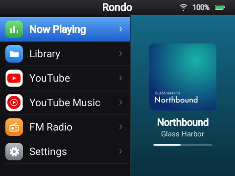
  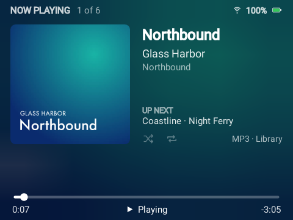
</p>

<p align="center">
  <a href="docs/install.md"><b>Install</b></a> ·
  <a href="docs/using.md"><b>Use</b></a> ·
  <a href="docs/server.md"><b>Server</b></a> ·
  <a href="docs/dashboard.md"><b>Dashboard</b></a> ·
  <a href="docs/troubleshooting.md"><b>Help</b></a> ·
  <a href="CHANGELOG.md"><b>What's new</b></a>
</p>

The Innioasis Y1 is a small music player with an iPod-style click wheel. Underneath, it runs
Android 4.2. Rondo is a firmware for it, built from the community's Android 4.2 base: everything
else is taken out, and the Y1 starts straight into menus made for the wheel. Play the music on
your microSD card, stream YouTube Music and YouTube, and listen to FM radio, all without a
touchscreen. You install it with Innioasis Updater CE, the same way as Rockbox or the Y1's
original software, and you can always go back.

## What it does

### Your music, from the card

Copy music onto the microSD card and Rondo sorts it by song, artist and album, using the files'
tags. You get covers, lyrics that scroll along with the song, search as you type, and playlists
you can make on the Y1 or in your browser. Videos on the card play too, and plugging the Y1 into a
computer turns the card into a USB drive.

<table>
  <tr>
    <td align="center">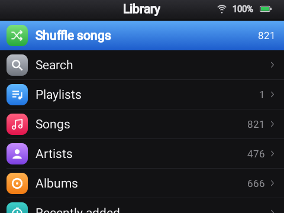<br>The library</td>
    <td align="center">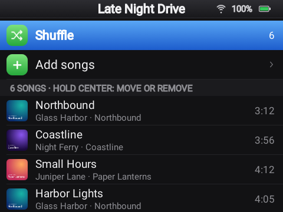<br>A playlist</td>
    <td align="center">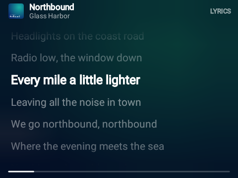<br>Lyrics that follow the song</td>
  </tr>
</table>

FLAC, MP3, M4A, AAC, OGG, Opus and WAV. Lyrics come from the file's tags or an `.lrc` file next to
it. Nothing on the card ever needs the internet.

### YouTube Music and YouTube

With a small server you run yourself, the Y1 streams YouTube Music and YouTube: home, search,
artists, albums, playlists, lyrics, Shorts, and video up to 720p. Sign the server in to your
YouTube account for your own library, subscriptions and history, or use it without an account.

<table>
  <tr>
    <td align="center">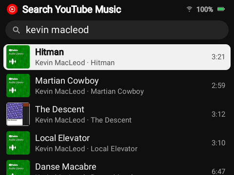<br>Searching YouTube Music</td>
    <td align="center">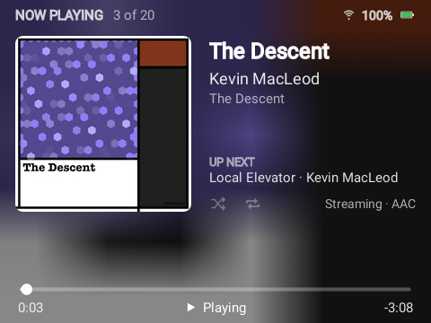<br>Streaming a song</td>
  </tr>
  <tr>
    <td align="center">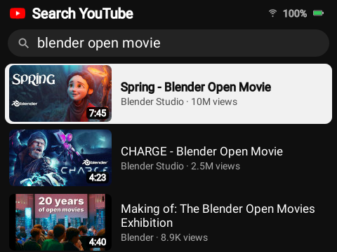<br>Searching YouTube</td>
    <td align="center">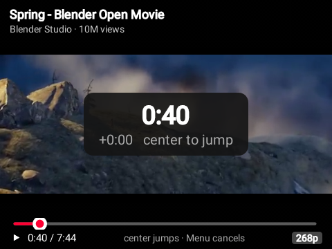<br>Watching a video</td>
  </tr>
</table>

Streams play as they arrive: neither the Y1 nor the server ever stores audio or video from
YouTube. (In the pictures: Kevin MacLeod's music and Blender Studio's open movie *Spring*, both
openly licensed.)

### Made for the wheel

Every screen works with the wheel and five buttons. Each wheel pulse is one step, like Rockbox,
with an optional buzz and click on every step and acceleration for long lists. Searches, Wi-Fi
passwords and playlist names are typed on a keyboard you move through with the wheel or the
buttons. Choose a light or dark look, an accent color and a text size, and which entries the main
menu shows, in which order.

<table>
  <tr>
    <td align="center">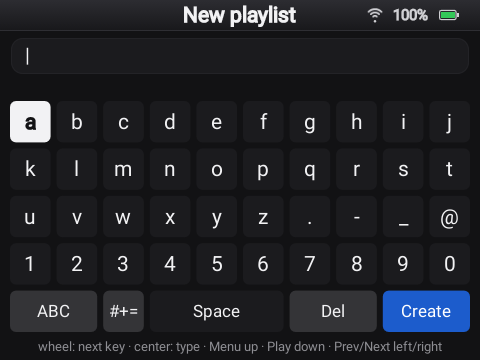<br>The wheel keyboard</td>
    <td align="center">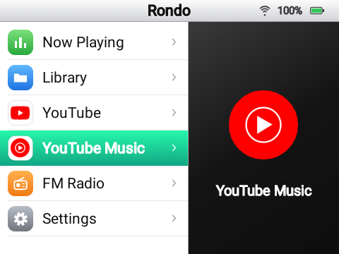<br>Light look, Mint accent</td>
    <td align="center">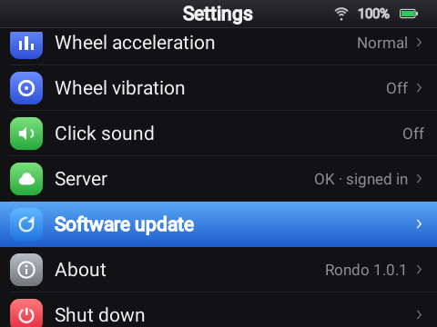<br>Settings</td>
  </tr>
</table>

### FM radio, Bluetooth and Wi-Fi

The Y1's FM radio, with station names, a scan of the whole band, saved stations and a speaker
option; wired headphones are the antenna. Bluetooth headphones and speakers, and Wi-Fi networks,
are set up from the wheel as well.

### A dashboard in your browser

Open **Settings › Dashboard** on the Y1, then the address it shows on your phone or computer.
From there you can upload music, make playlists, control what's playing, change the theme and
every setting, manage Wi-Fi, Bluetooth and the radio, and shut down, restart or update the Y1. It
runs on the Y1 itself, over your Wi-Fi, and needs no internet.

<p align="center">
  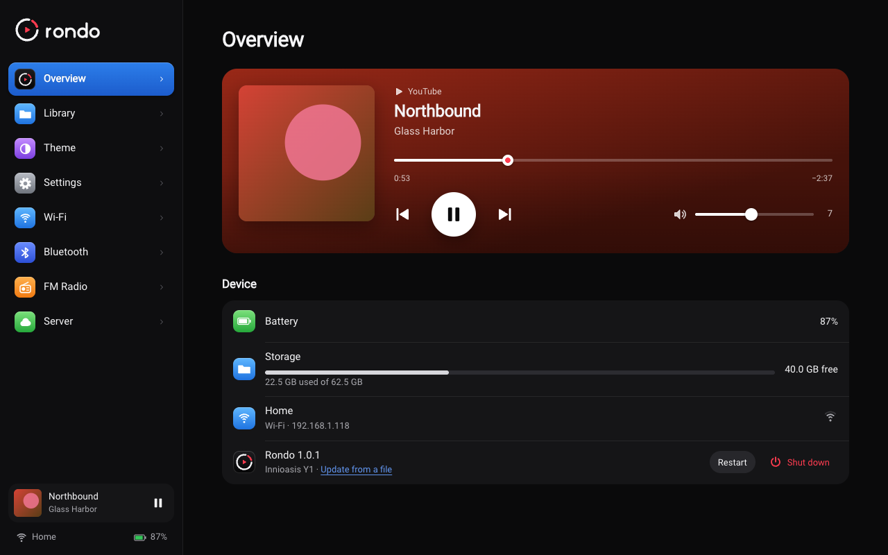
  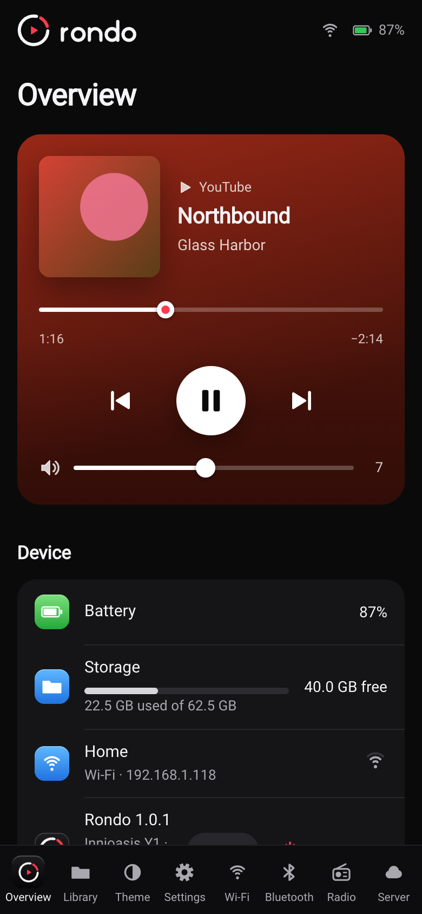
</p>

### Updates that keep everything

A new Rondo installs in about a minute, without reinstalling the firmware: from **Settings ›
Software update** over Wi-Fi, with **Install** in the dashboard, or over USB from
[the update page](https://jarvissax.github.io/rondo/). Your settings, Wi-Fi, server connection,
playlists and music stay as they are. The rare release that changes the firmware itself says so,
and installs with Innioasis Updater CE instead.

## What you need

- An **Innioasis Y1, Type A**: one that shipped with software 2.0.0 or later. Not sure which type
  yours is? See [Before you start](docs/install.md#before-you-start).
- A **computer** (macOS, Windows or Linux) with **Innioasis Updater CE**, and a USB-C cable that
  carries data, for the install.
- **2.4 GHz Wi-Fi.** The Y1 can't see 5 GHz networks.
- For YouTube Music and YouTube, a **Rondo server**: a computer at home that stays on (a 64-bit
  Raspberry Pi or a NAS is fine), or a small VPS. Your music card, the radio and Bluetooth work
  without it.

## Getting started

1. **[Install Rondo](docs/install.md)** with Innioasis Updater CE: choose the Y1, Type A, then
   Rondo. It takes about 10 minutes, and your microSD card isn't touched.
2. **[First start](docs/install.md#first-start):** join Wi-Fi, copy your music onto the card, and
   look through Settings.
3. **[Set up a server](docs/server.md)** if you want YouTube Music and YouTube. About 15 minutes
   with Docker.
4. **[Learn the controls](docs/using.md)**, and open the **[dashboard](docs/dashboard.md)** on
   your phone.

### The controls at a glance

| Control | What it does |
| --- | --- |
| **Wheel** | Moves through lists. On Now Playing, a video or the radio, it changes the volume. |
| **Center** | Opens or selects. **Hold** it for options. |
| **Menu** (top) | Back. |
| **Play/Pause** (bottom) | Plays and pauses, from any screen. |
| **Next / Previous** | Next or previous song. **Hold** to fast-forward or rewind. |
| **Power** | Screen off and on. **Hold** it to shut down or restart. |

[Using Rondo](docs/using.md) has the details for every screen, and every setting.

## Your own server

<p align="center">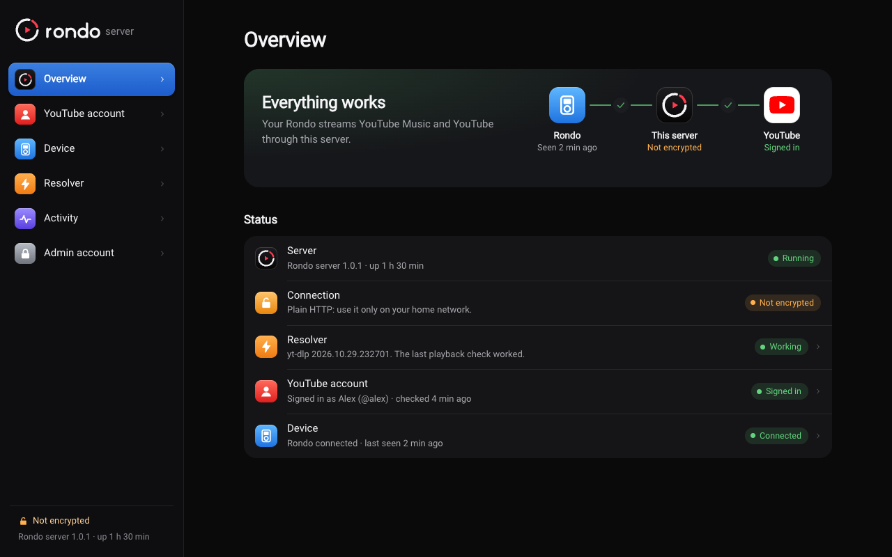</p>

The Y1 is too old to talk to YouTube directly: Android 4.2 can't handle today's YouTube pages,
video formats or encryption. So a small server does that part. You run it with Docker at home or
on a VPS, set it up from its admin page in the browser, connect your Y1 with a six-digit code, and
optionally sign it in to your YouTube account. It keeps yt-dlp up to date by itself, its admin
page tells you when something needs attention, and a new version of the server installs with one
click there. One server serves one Y1. See
[Setting up a Rondo server](docs/server.md).

## How it works

```
 Innioasis Y1                 your Rondo server                YouTube
┌──────────────┐   Wi-Fi    ┌───────────────────┐   internet  ┌─────────┐
│ Rondo        │ ─────────▶ │ browse + stream   │ ──────────▶ │         │
│ music on SD  │ ◀───────── │ (Node, yt-dlp)    │ ◀────────── │         │
│ FM, Bluetooth│   audio,   └───────────────────┘             └─────────┘
└──────────────┘   video
```

The server browses YouTube for the Y1 with [youtubei.js](https://github.com/LuanRT/YouTube.js),
finds the streams with [yt-dlp](https://github.com/yt-dlp/yt-dlp), and passes audio and video
through to the Y1 in a form it can play. The Y1 only ever talks to your server.

## The project

| Folder | What's in it |
| --- | --- |
| `app/` | Rondo itself, the Android app at the heart of the firmware (Kotlin, classic Views, ExoPlayer 2) |
| `firmware/` | The script that builds the firmware (`rom.zip`) from the community's base ROM |
| `server/` | The Rondo server (Node 22, TypeScript, Fastify) |
| `infra/` | Docker and Caddy files for running the server |
| `web-updater/` | The update page (WebUSB), published on GitHub Pages |
| `tools/` | Mock servers for UI work, the boot screen generator, the version script |
| `docs/` | Guides, plus [notes on the Y1's internals](docs/device/README.md) and [API references](docs/dev/) |

Every release is built the same way: the signed app goes up, and GitHub Actions builds the
firmware from it and publishes the update page. To build it yourself, start with
**[Building Rondo](docs/building.md)**.

## Feedback and contributing

If you try Rondo on your Y1, I'd love to hear how it went, good or bad.

- **[Report a problem](https://github.com/jarvissax/rondo/issues/new?template=bug_report.yml)**
  if something doesn't work.
- **[Share an idea](https://github.com/jarvissax/rondo/issues/new?template=idea.yml)** for
  something you'd like Rondo to do.
- **[CONTRIBUTING.md](CONTRIBUTING.md)** says what feedback helps most, how to get Rondo's log,
  and how to work on the code.

## Thanks

Rondo stands on other people's work:

- The **[y1-community](https://github.com/y1-community)**: its
  [Innioasis Updater CE](https://github.com/y1-community/Innioasis-Updater), which installs Rondo,
  and its [Android 4.2 base ROM](https://github.com/y1-community/y1-ata-rom), with the Y1's
  Wi-Fi switched on, which Rondo's firmware is built from.
- **[Rockbox's Y1 port](https://github.com/multiwirth/rockbox-y1)**, whose wheel handling Rondo
  copies, and the **[JJ Launcher](https://github.com/ismileblue/y1_launcher)** and
  **[Inniclassic](https://github.com/FabianZettl/inniclassic)** launchers, which showed how the
  Y1's buttons behave.
- **youtubei.js**, **yt-dlp**, **ExoPlayer**, **OkHttp**, **NanoHTTPD**, **ZXing**, **Fastify**,
  **sharp** and the **Roboto** font. See [THIRD_PARTY_NOTICES.md](THIRD_PARTY_NOTICES.md).

## License and fine print

Rondo is released under the [MIT License](LICENSE).

Rondo is an independent project. It isn't affiliated with or endorsed by Innioasis, Google or
YouTube. YouTube and YouTube Music are trademarks of Google LLC. Rondo reaches YouTube the same way
other unofficial clients do, which YouTube's terms don't allow and which YouTube can break at
any time. Use your own account, and use it at your own risk. The songs and albums in the pictures
of the card's library are made up for the screenshots.
