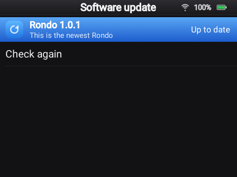

# Installing Rondo

Rondo is a firmware for the Innioasis Y1: you install it the way you'd install Rockbox or the
Y1's original software, with **Innioasis Updater CE**. The Y1 then starts straight into Rondo.
After that, updates take a minute and keep everything (see [Updating](#updating-rondo)).

## Before you start

- **Your Y1 has to be a Type A.** That's a Y1 that shipped with software 2.0.0 or later; the
  Updater asks which type yours is. If yours came with software older than 2.0, or you bought it
  between 2024 and May 2025, treat it as a **Type B**: Rondo isn't for it yet, and a Type A
  firmware can leave a Type B unable to start.
- **Installing replaces everything on the Y1 itself**: the original player, Rockbox, settings.
  **Your microSD card isn't touched**, so your music stays where it is.
- **Charge the Y1** to at least half.
- Use a **USB-C cable that carries data**. Some charging cables don't, and nothing will work
  with them.

## Install with Innioasis Updater CE

1. Download **Innioasis Updater CE** for your computer from its
   [guide page](https://www.innioasis.app/guide.html), which shows the download and drivers for
   your system. On Windows, let it install its drivers and restart the computer once before the
   first install.
2. Open it, choose **Y1** and **Type A** (not sure? see [Before you start](#before-you-start)).
3. In the software list, choose **Rondo**, then **Install**.
4. Do what the Updater asks: switch the Y1 completely off, then plug it in. The Updater installs
   Rondo by itself in about 7 minutes. Don't unplug anything until it says it's done.
5. **Press the Y1's Power button** to switch it on. The first start takes a couple of minutes
   (Android prepares every app once); later ones take about 30 seconds. You'll see Rondo's logo,
   its spinning click wheel, and then the main menu.

### From a file

The same thing, with the file downloaded by hand:

1. Download **`rom.zip`** from Rondo's [latest release](https://github.com/jarvissax/rondo/releases/latest).
2. In Innioasis Updater CE, open **Settings**, choose **Install from a file…**, and pick the
   `rom.zip` you downloaded.
3. Press **Install / Restore** and follow steps 4 and 5 above.

The Updater deletes the `rom.zip` once it has unpacked it, so download it again if you need it later.

## First start

1. **Wi-Fi:** Settings › Wi-Fi. Turn the wheel to pick your network and type the password on the
   on-screen keyboard. Only 2.4 GHz networks show up.
2. **Your music:** plug the Y1 into your computer. Rondo asks whether to use it as a **USB drive**;
   choose it, and the microSD card shows up on your computer. Copy music and videos onto it (any
   folders), eject it on the computer, then choose **Turn off USB drive** on the Y1. Music from
   any music player works: FLAC, MP3, M4A, AAC, OGG, Opus and WAV.
3. **YouTube Music and YouTube:** [set up a server](server.md), then connect the Y1 to it in
   **Settings › Server › Connect to a server**.

Then see [Using Rondo](using.md) for what the wheel and each button do.

## Updating Rondo

A new Rondo comes as a small update you install over the one you have, without flashing the Y1
again. Your settings, Wi-Fi, server connection, playlists and music all stay. Use whichever is
handiest:

- **On the Y1, over Wi-Fi:** **Settings › Software update** shows when a newer Rondo is out.
  Choose **Install now**; Rondo downloads it (through your server), installs it and restarts by
  itself. This needs a [Rondo server](server.md).
- **From the dashboard, over Wi-Fi:** open **Settings › Dashboard** on the Y1 and the page on
  your phone or computer. The Overview says when a newer Rondo is out; press **Install**. No
  server needed. **Update from a file**, under the Rondo row, installs an APK you downloaded.
- **Over USB:** open **[jarvissax.github.io/rondo](https://jarvissax.github.io/rondo/)** in
  Chrome or Edge, plug the Y1 in, press **Connect Y1**, then **Update**. Nothing to install on the
  computer. With adb, it's `adb install -r rondo-<version>.apk`.

Only Rondo's own releases install this way: Android checks that an update is signed with the same
key as the Rondo in the firmware.

Now and then a release also changes the firmware around Rondo (a new permission, the boot screen
or Android's settings, for example). The Y1, the dashboard and the update page recognize such a
release: instead of **Install**, they say it needs a new firmware. Install it with Innioasis
Updater CE, [the same way as the first time](#install-with-innioasis-updater-ce). If the Updater
offers **Keep Data**, choose it and your settings, Wi-Fi and server connection stay too; without
it they're reset (your music on the card is never touched).

## Going back

Rondo doesn't lock anything. To return to the Y1's original software, or to try Rockbox or
another firmware, choose it in Innioasis Updater CE and install it the same way. **Original
Software** brings the Y1 back to how it came. Your microSD card stays as it is.
