# Using Rondo

Rondo is built around the wheel and five buttons. The same few moves work everywhere, and a few
screens give them an extra meaning.

## The basics

| Control | What it does |
| --- | --- |
| **Wheel** | Moves through lists. On Now Playing, a video or the radio, it changes the volume. |
| **Center** | Opens or selects. |
| **Hold center** | Options for the highlighted item or the current screen. |
| **Menu** (top) | Back. |
| **Play/Pause** (bottom) | Plays and pauses, from any screen. |
| **Next / Previous** | Next or previous song, from any screen. |
| **Hold Next / Previous** | Fast-forward or rewind. |
| **Power** | Switches the screen off and on. **Hold it** to shut down or restart. |

When the screen is off, any press (a button, center or the wheel) only wakes it: nothing else
happens, so a press in your pocket never skips a song. Within 5 seconds of the screen dimming or
going dark by itself, a press wakes it and does what it does (after Power, a press still only
wakes it). A **wired headset's buttons** (play/pause, next, previous, volume) work with the screen
on or off, like Bluetooth headphones' buttons.

## Main menu

**Now Playing**, **Library**, **YouTube**, **YouTube Music**, **FM Radio** and **Settings**. The
right side shows what's highlighted, or what's playing. **Settings › Display › Theme › Main menu** changes
the order and which entries show up.

  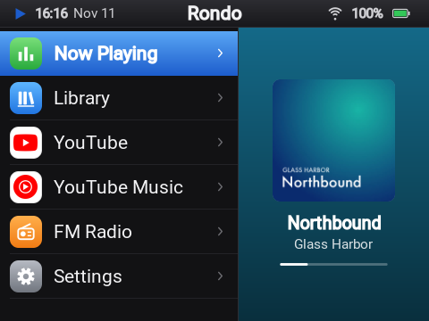
  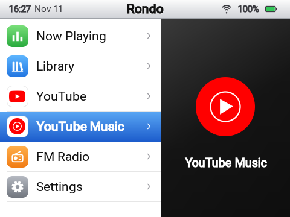

## Library: music, videos, photos and files

Rondo looks through the whole microSD card (and the Y1's internal storage) for music, videos and
photos. You don't need a special folder layout. Songs are listed by title, artist and album,
using the files' tags. Without tags, a file named `Artist - Title.flac` is read the obvious way.

Library has four parts: **Music**, **Videos**, **Photos** and **Files**.

**Music** starts with Shuffle songs and Search, then **Browse** (Songs, Artists, Album artists,
Albums, Cover Flow, Genres), **Playlists**, **Listening** (Recently added, Most played,
Recently played, Top rated) and **The card** (Rescan, Organize). Every list of songs starts with
**Shuffle**.

  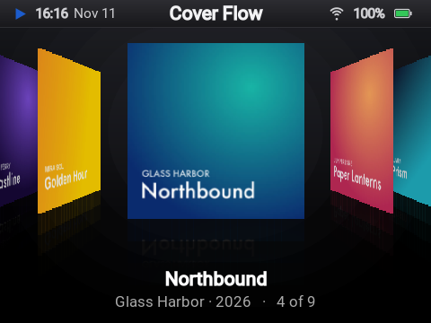
  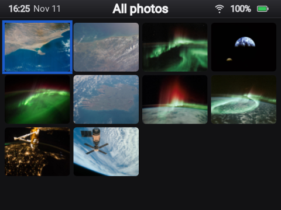

- **Search** finds songs, artists, albums, videos and playlists as you type, on the wheel
  keyboard. Songs, Artists, Albums, Videos and Playlists each start with a Search of their own.
- **Album artists** and **Genres** group songs by their album artist (else their artist) and their
  genre tag. **Albums** show the album artist and the year; two albums of one name by different
  artists stay apart, and an album's songs play in disc and track order.
- **Cover Flow** shows the albums' covers on a wide stage, the one in front facing you and the
  others turned and set back, each above its reflection: turn the wheel to glide through them
  (Next and Prev jump ten), press center for the album's songs.
- **Recently added** lists the newest songs first.
- **Most played**, **Recently played** and **Top rated** (4 stars and up): a song counts as played
  once it's half over or 4 minutes in.
- **Playlists:** **New playlist**, then **Add songs** (or hold center on any song and choose
  **Add to playlist**). Hold center on a song in a playlist to move it or take it out, and on a
  playlist to rename or delete it. Playlists are `.m3u8` files in the card's `Playlists` folder,
  so music players on a computer open them too. **Smart playlists**, made on the
  [dashboard](dashboard.md#library) from rules (a genre, a year, what you play and rate), are listed
  below them and pick their songs anew each time you open one.
- **Hold center on a song** to play it now, play it next, add it to the queue or a playlist, or
  delete it from the card.
- **Videos** lists all the videos on the card, the newest first, and each folder that has some.
  YouTube videos you downloaded are there too, in `Videos/YouTube`.
- **Photos** shows the JPEG and PNG pictures on the card and the internal storage, by folder (and
  all of them, the newest first), as a grid: turn the wheel to pick one, press center to see it full
  screen. There the wheel (or Next and Prev) slides from one to the next, center shows its name and
  date, and Play starts or stops a slideshow. Pictures from a camera show the right way up.
- **Files** is a file manager for the card and the internal storage: every folder and file, not
  only music. Center opens a folder, plays a song (the folder's songs after it, an album's in disc
  and track order), a video or a photo.
  **Hold center** on a file or folder to **Rename** it, **Copy** or **Move** it to another folder
  (on either storage: between the two it copies in the background, and the list says how far it
  is), or **Delete** it. Each folder starts with **New folder**. Songs keep their plays, ratings and
  playlists when they move.
- **Rescan the card** after copying files to it another way than the USB drive.
- **Organize the card** puts every song in `Music/Artist/Album (Year)/01 - Title` (a `Disc 1`
  folder for each disc of a multi-disc album), episodes in `Shows/Series (Year)/Season 01/` and
  other videos in `Movies/Title (Year)/`, the way Jellyfin, Plex and Kodi expect, from the tags. It
  shows how many files would move and where (**See the moves**) and moves nothing until you choose
  **Organize**. Lyrics (`.lrc`), subtitles and a one-album folder's cover picture go along, and so
  do your playlists, plays, ratings and the queue.
- **Formats:** every common one for music: MP3, AAC and M4A/M4B (with ALAC), FLAC, Ogg Vorbis,
  Opus, WAV, AIFF, WMA (and WMA Lossless), APE, WavPack, AC-3 and E-AC-3, DTS, DSD (DSF and DFF),
  TTA, TAK, Musepack, MKA, CAF, AMR, MP2 and AU; surround is mixed down to stereo. MP4 (H.264) and
  similar for video, with `.srt`, `.vtt` and `.ass` subtitles beside it. **Covers** come from the
  file's embedded artwork. **Lyrics** come from the file's tags or from an `.lrc` file with the
  same name next to it, and timed lyrics scroll along. Songs on the card never fetch anything from
  the internet.

### Adding music

Plug the Y1 into a computer and choose **Use as USB drive**: the microSD card shows up on the
computer like a memory stick. Copy files onto it, eject it on the computer, then choose **Turn off
USB drive** on the Y1. While the card is on the computer, music from it is paused. Unplugging the
cable gives the card back to the Y1 as well. The dashboard can also upload music over Wi-Fi.

## YouTube Music and YouTube

Both work as soon as the Y1 is on Wi-Fi: Rondo talks to YouTube itself, with nothing to set up.
(If you'd rather it went through a [server](server.md) of your own, choose **My server** in
**Settings › YouTube › Connection**.) They open on a home page, with tabs across the top: turn the
wheel on the tab row and press center to switch. **Search** uses an on-screen keyboard you type on
with the wheel.

- **Signed in**, you also get **Library** (your playlists and Liked Music) in YouTube Music, and
  **Subscriptions** and **History** in YouTube, whose home is then picked for you. Sign in with a
  code in **Settings › YouTube › YouTube account** (see [Settings](#settings)); with a server, the
  server's own account counts. YouTube Music's own home and history also need a cookies.txt (on
  the dashboard's YouTube page, or the server's admin page).
- **Hold center on a song** to play it now or next, add it to the queue, or **Start radio**
  (songs like this one).
- Songs stream as YouTube's Opus, or its AAC where a song has no Opus; Now Playing says which
  ("Streaming · Opus").
- Videos play at the quality set in **Settings › YouTube › Video quality** (Auto picks up to
  360p, the screen's size; up to 720p works). A video without that height plays the next one down.
- **Hold center on a video** to download it to the card (720p, 480p or 360p) with its subtitles, to
  watch with no connection. **YouTube › Home › Downloads** lists them (also with no connection):
  center plays one, hold center deletes it, and one on its way can be canceled there. They're saved
  in `Videos/YouTube` on the card, so Library › Videos has them too.

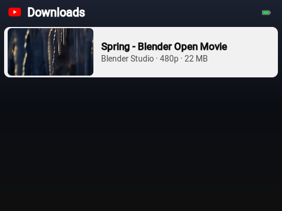

### Shorts

YouTube's home page starts with **Shorts**: one short at a time, looping, picked for your account
when you're signed in. **Next / Previous** move to the next or previous short,
the **wheel** is the volume and **center** pauses. Moving on slides like on a phone: the short
slides up and away as the next one comes in from below. The next few shorts load while you watch,
so moving on takes about a second.

## Now Playing

  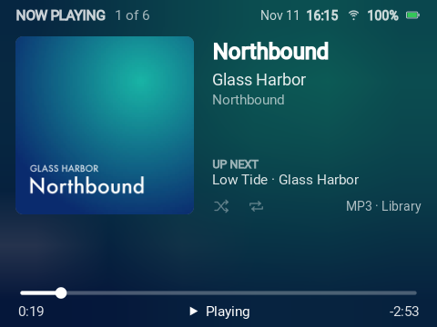
  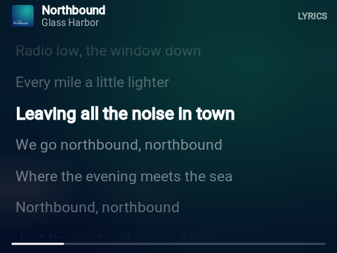

- **Wheel:** volume. **Center:** switch between the cover and the lyrics.
- **Next / Previous:** the next or the song before; the cover slides in from that side.
- **Hold center** for options: scrub through the song, see what's up next, shuffle and repeat,
  and for a song on the card its **rating**: center gives it one star more (after five, none).
- **Hold Next / Previous** to scrub: the wheel then moves the position, and center jumps there.
  Menu cancels.

## Watching a video

  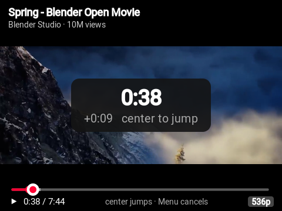
  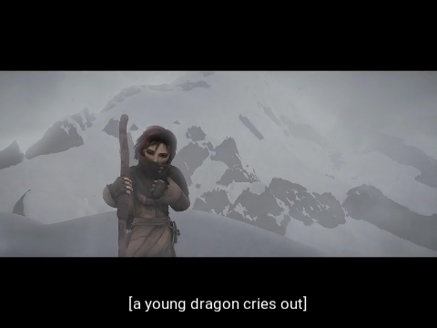

- **Wheel:** volume. **Center:** scrub. **Next / Previous:** 10 seconds forward or back.
- **Hold center** for the options: **Quality** (YouTube), **Subtitles** (Off, or one of the video's
  tracks) and **Download** (YouTube: to the card at the height picked). A YouTube video's tracks are
  its own and the speech recognition's; a video on the card has the subtitle files beside it
  (`Movie.srt`, `Movie.en.srt`, `Movie.en.forced.ass`…). The language picked last is shown first
  in the next video.

## FM radio

Plug in **wired headphones** first: their cable is the antenna.

- **Wheel:** volume. **Center:** switch the wheel to tuning, in 0.1 MHz steps, and back.
- **Next / Previous:** find the next station up or down.
- **Play/Pause:** mute.
- **Hold center** for options: your saved stations, **Scan** (finds every station, about 20
  seconds), save or remove this one, play through the **speaker**, and the **region**. "Most of
  the world" is 87.5–108 MHz; Japan is 76–95 MHz. In the stations list, hold center on a saved
  station to rename, move or remove it, or on a found one to save it.

Station names come from RDS where the station sends it. Starting YouTube or a song from the card
turns the radio off.

## Settings

  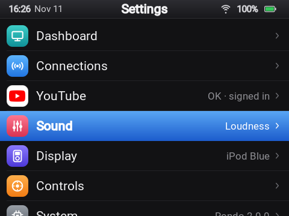
  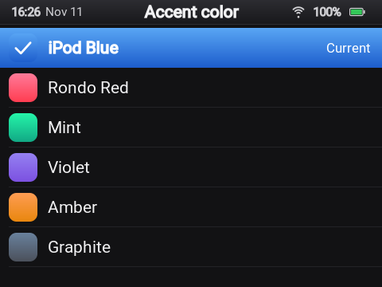

Settings has the **Dashboard** at the top, then six groups: **Connections** (Wi-Fi, Bluetooth),
**YouTube** (the connection, the account, video quality), **Sound**, **Display** (theme,
brightness, screen off, subtitles, lyrics), **Controls** (the wheel) and **System** (date and
time, updates, About, shut down).

| Setting | |
| --- | --- |
| **Dashboard** | Starts the dashboard; see below. |
| **Connections › Wi-Fi** | Join networks. Hold center on a saved network to forget it. |
| **Connections › Bluetooth** | Pair and connect headphones or speakers. |
| **YouTube › Connection** | **Directly to YouTube** (no server needed; what a Y1 without a server uses) or **My server**, the [Rondo server](server.md) you connected. Below: the address, a **Connection test**, **Connect to a server** with its address and the code from its admin page, and **Use a token instead**. A switch shows the new source's home and tabs at once. |
| **YouTube › YouTube account** | Directly to YouTube: **sign in with a code**, as a smart TV does. The Y1 shows a code; open google.com/device on your phone or computer, enter it and allow access, and the screen closes by itself. That brings YouTube's home for you, Subscriptions and History, and your YouTube Music playlists and Liked Music. YouTube Music's own home and history also need a cookies.txt (on the dashboard's YouTube page). The sign-in stays on the Y1; choose the row again to sign out. With a server, this row isn't there: the server's own account counts. |
| **YouTube › Video quality** | Auto (up to 360p), or 720p, 480p or 360p. A video without that height plays the next one down. |
| **Sound** | See [Sound](#sound) below. |
| **Display › Theme** | The accent color, light or dark, the text size, and the main menu's entries and order. |
| **Display › Brightness**, **Screen off after** | |
| **Display › Subtitles** | Subtitles on or off, the language looked for first, and their look: size, text color and opacity, background color and opacity, edges (drop shadow, raised, depressed, outline). A line at the top shows them as they'll look. **Use YouTube's look** goes back to YouTube's own (white on a 75 % black box). |
| **Display › Open lyrics automatically** | Shows lyrics instead of the cover when a song has them. |
| **Controls › Wheel acceleration** | Long, fast spins move further. |
| **Controls › Wheel vibration** | A small buzz on every wheel step: off, light, normal or strong. |
| **Controls › Click sound** | A tick on every wheel step. |
| **System › Date & time** | The time and the time zone, each set automatically (from the network, and the time zone of wherever the Y1 is online) or by hand, and 24-hour time or AM/PM. |
| **System › Software update** | Checks GitHub for a newer Rondo and installs it over Wi-Fi, keeping everything, or says when a release needs Innioasis Updater CE ([more](install.md#updating-rondo)). No server needed. |
| **System › About** | Rondo's version, the battery, free space on the card and the internal storage, Wi-Fi, the IP and MAC addresses, the time zone and where YouTube comes from. |
| **System › Shut down** | Shut down or restart. Holding the Power button opens the same choices. |

  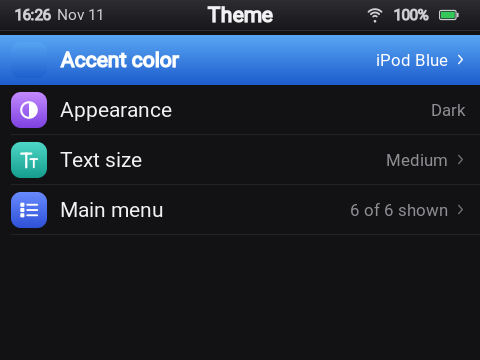
  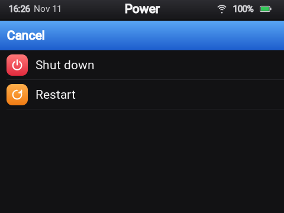

### Sound

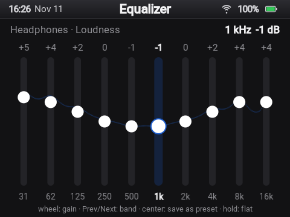

**Settings › Sound** shows the output music plays on now (**Playing on**: the speaker, wired
headphones or a Bluetooth device). Each output keeps its own sound:

- **Equalizer:** a preset, your own bands (**Custom**), or a preset you saved.
- **Edit equalizer:** a slider for each of the ten bands, ±12 dB. The wheel sets the gain, Next
  and Previous pick the band, center saves the bands as a preset of your own (for every output),
  and holding center sets them flat.
- **Headphone match** (headphones only): a correction for your headphone model from
  [AutoEq](https://github.com/jaakkopasanen/AutoEq)'s measurements. Search by model; this one
  needs a [server](server.md), which looks the model up.
- **Loudness boost:** up to 12 dB louder, with the peaks held so they never clip.

Under **Every output**:

- **Volume leveling:** songs at one loudness, measured as they play and while the Y1 charges.
- **Amplifier:** the Y1's own amplifier, Standard as it ships, or +2, +4 or +6 dB louder for
  headphones and the speaker; the loudest steps add some hiss.
- **Volume limit:** the loudest step the wheel goes to, on every output (No limit as it ships).

## The dashboard

**Settings › Dashboard** turns the Y1 into a small web server for as long as that screen is
open. It shows an address, a QR code of it and a 6-digit code. Open the address in a browser on
the same Wi-Fi and type the code. From there you can:

- see what's playing and control it, and shut down, restart or update Rondo,
- browse, search, upload and delete music, videos and photos, manage the card's files and
  folders, organize the card, and make playlists and smart playlists,
- change the theme, the sound, the menu and every setting above,
- manage Wi-Fi, Bluetooth and the FM radio, sign in to YouTube, download YouTube videos, and
  connect a server.

Leaving the Dashboard screen on the Y1 (Menu) stops it. See [The dashboard](dashboard.md) for
each page.
